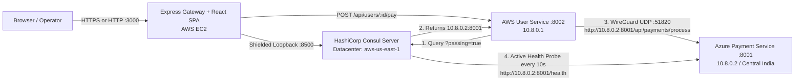

# Cross-Cloud Service Discovery Registry

A production-verified **Cross-Cloud Service Discovery Registry** built with a **React + TypeScript** frontend, a **Node.js / Express 5** API Gateway, **HashiCorp Consul** service registry, and live microservices deployed across **AWS EC2 (`us-east-1`)** and **Microsoft Azure (`Central India`)** connected via an encrypted **WireGuard VPN tunnel**.

> **Note on Scope & Limitations:**
> - **Cross-Cloud Networking & Discovery:** Real distributed microservices running on separate AWS EC2 and Azure VMs communicating privately over WireGuard (`10.8.0.1 <-> 10.8.0.2`, UDP `51820`) via dynamic HashiCorp Consul discovery (`aws-us-east-1`).
> - **Simulated Payments:** Transaction processing is simulated (`POST /api/payments/process`); no real banking gateways or financial accounts are connected.
> - **In-Memory Telemetry:** Transaction counters and recent history are held in memory inside the AWS User Service (`user-service.js`) and reset if the service process restarts.

---

## Architecture Overview



### Verified Cloud Topology

| Component | Cloud / Location | Private / VPN IP | Port | Management |
| :--- | :--- | :--- | :--- | :--- |
| **Express Gateway + React SPA** | AWS EC2 (`us-east-1`) | `172.31.20.133` / `10.8.0.1` | `3000` | `systemd` (`crosscloud-gateway`) |
| **AWS User Service** | AWS EC2 (`us-east-1`) | `10.8.0.1` | `8002` | `systemd` (`user-service`) |
| **HashiCorp Consul Server** | AWS EC2 (`us-east-1`) | `127.0.0.1` (shielded) | `8500` | `systemd` (`consul`) |
| **Azure Payment Service** | Azure VM (`Central India`) | `172.16.0.4` / `10.8.0.2` | `8001` | `systemd` (`payment-service`) |
| **WireGuard VPN Overlay** | AWS ↔ Azure | `10.8.0.1` ↔ `10.8.0.2` | `51820/UDP` | `systemd` (`wg-quick@wg0`) |

### Core Frontend Pages (React + TypeScript)
- **Overview Dashboard (`/`)** — Live health states (`PASSING`, `CRITICAL`, `UNKNOWN`) for AWS User Service, Azure Payment Service, Consul, and WireGuard VPN; AWS-to-Azure communication diagram; functional Payment Simulator; and live transaction telemetry table.
- **Service Registry (`/service-registry`)** — Live Consul catalog table (`GET /v1/catalog/services` + `/v1/health/service/:name`), tags (`AZURE`, `central-india`), last check output, live backend probing, registration form, and deregistration.
- **Service Discovery (`/service-discovery`)** — Dynamic service resolution with `?passing=true` filtering, exclusion status check for `payment-service`, DNS SRV preview, and client snippets.
- **Health Monitoring (`/health-monitoring`)** — Aggregated Consul health check monitoring, critical exclusion alerts, manual HTTP probes, and fault-injection/recovery controls.
- **Settings (`/settings`)** — Live diagnostics for Consul datacenter (`aws-us-east-1`), WireGuard tunnel state, Express Gateway API, and UI preferences.

---

## Project Structure

```text
cross-cloud-service-discovery/
├── frontend/                     # React 18 + TypeScript + Vite SPA
│   ├── src/
│   │   ├── components/           # Header, Sidebar (responsive mobile drawer), Toast, RegisterServiceModal
│   │   ├── pages/                # Dashboard, ServiceRegistry, ServiceDiscovery, HealthMonitoring, Settings
│   │   ├── services/             # Typed API client using VITE_API_BASE_URL
│   │   ├── types/                # TypeScript contracts
│   │   └── vite-env.d.ts         # Vite environment typing
│   ├── .env.example              # Frontend environment template
│   └── package.json
├── deploy/                       # Cloud & WireGuard provisioning scripts
│   ├── aws/                      # AWS User Service & Express Gateway setup scripts
│   ├── azure/                    # Azure Payment Service setup script
│   ├── consul/                   # Consul server HCL configuration
│   ├── wireguard/                # WireGuard peer tunnel scripts
│   └── README_DEPLOYMENT.md      # Complete AWS + Azure deployment runbook
├── documentation/                # Architecture guides, Viva Q&A & Demo Presentation Guide
├── test/
│   └── backend.test.js           # 28 automated integration tests (node:test)
├── server.js                     # Express 5 API Gateway & static React SPA host
├── user-service.js               # AWS User Service (dynamic Consul discovery & payment client)
├── payment-service.js            # Azure Payment Service (transaction processor & /health probe)
├── start-all.js                  # Local unified launcher (Gateway + User + Payment)
├── .env.example                  # Backend environment template
└── package.json                  # Root Node.js manifest
```

---

## API Endpoints Reference

### Express Gateway (`server.js` — Port `3000`)
- `GET /api` — Gateway overview and metadata
- `GET /api/dashboard/overview` — Live aggregated status (AWS User Service, Azure Payment Service, Consul, WireGuard, telemetry)
- `GET /api/consul/status` — Consul leader, datacenter, node name, and connection state
- `GET /api/consul/catalog` — Full Consul catalog (`GET /v1/catalog/services` + `/v1/health/service/:name`)
- `GET /api/consul/health/payment-service` — Compares registered vs `?passing` healthy discovery instances
- `GET /api/services` — List agent-registered services
- `POST /api/services/register` — Validate & register a service with Consul (detects duplicate IDs with `409 Conflict`)
- `DELETE /api/services/:id` — Deregister a service instance
- `GET /api/services/:name` — Discover service instances (`?passing=true` supported)
- `POST /api/services/probe` — Trigger a live backend HTTP GET probe for a registered service
- `GET /api/health` — Aggregated Consul health check summary
- `GET /api/users` — Proxy to AWS User Service users list
- `POST /api/users/:id/pay` — Proxy cross-cloud payment trigger to AWS User Service
- `GET /api/telemetry` — Proxy live in-memory telemetry from AWS User Service
- `POST /api/scenarios/inject-fault` & `/restore-health` — Trigger simulated HTTP 503 failure / 200 recovery on Payment Service (resolved via Consul)

### AWS User Service (`user-service.js` — Port `8002`)
- `GET /health` — Service health probe
- `GET /api/users` / `GET /api/users/:id` — Mock user accounts
- `POST /api/users/:id/pay` — Queries Consul `?passing=true`, discovers Payment Service IP:Port, and dispatches cross-cloud payment
- `GET /api/telemetry` — Returns in-memory cross-cloud request counters and history

### Azure Payment Service (`payment-service.js` — Port `8001`)
- `GET /health` — Health probe returning HTTP `200` (healthy) or `503` (unhealthy)
- `POST /api/payments/process` — Validates and processes simulated payment transaction
- `POST /simulate/unhealthy` / `POST /simulate/healthy` — Toggles simulated health status for fault-tolerance demonstrations

---

## Running Locally (Development / Fallback Mode)

```powershell
# 1. Install dependencies & build frontend
npm install
npm --prefix frontend install
npm --prefix frontend run build

# 2. Terminal 1: Start local Consul agent
.\consul.exe agent -dev

# 3. Terminal 2: Start Payment (:8001), User (:8002), and Gateway (:3000)
node start-all.js
```

Visit **[http://localhost:3000](http://localhost:3000)**.

---

## Automated Testing

Run the integration test suite (requires Gateway, User Service, Payment Service, and Consul running):
```bash
npm test
```
All **28 integration tests across 8 suites** verify input validation, duplicate detection (`409`), Consul registration/discovery, real payment routing (`POST /api/users/usr_101/pay`), telemetry counters, fault injection, and recovery.
