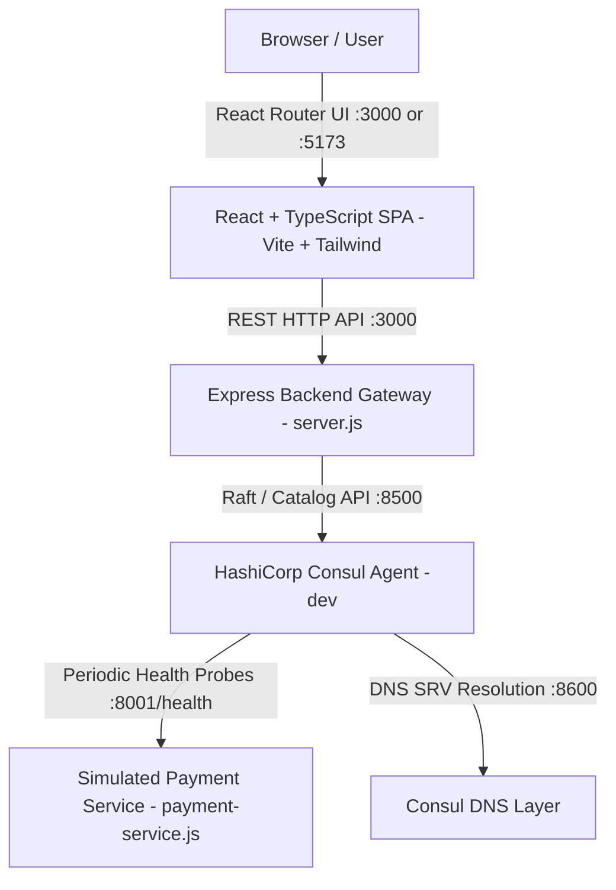

# Cross-Cloud Service Discovery Registry

A lightweight, enterprise-grade **Cross-Cloud Service Discovery Registry** built with a modern **React + TypeScript** frontend and a robust **Node.js / Express** backend integrating with **HashiCorp Consul**.

This system demonstrates dynamic microservice registration, health probing, multi-cloud catalog aggregation, and resilient service discovery across simulated AWS, GCP, and Azure topologies.

> **Note on Scope:** This project is a **local simulation** using a local HashiCorp Consul agent and local mock microservices. Real AWS, GCP, and Azure cloud infrastructure is **not provisioned**; instead, provider metadata and failover policies are modeled to simulate cross-cloud multi-region topologies.

---

## Architecture Overview



### Component Roles & Ports
- **React Frontend SPA**:
  - Production (served by Express): `http://localhost:3000`
  - Development (Vite Dev Server): `http://localhost:5173`
- **Express Backend API**: `http://localhost:3000` (Gateway for registration, discovery, health aggregation)
- **HashiCorp Consul Daemon**: `http://localhost:8500` (Consul Web UI at `/ui/`, Raft RPC at `8300`, DNS at `8600`)
- **Simulated Payment Service**: `http://127.0.0.1:8001/health` (Mock microservice returning live JSON telemetry)

### Core Frontend Pages (React + TypeScript)
- **Dashboard (`/`)** — Real-time overview of total services, healthy/unhealthy breakdown, multi-cloud provider stats, live Consul Serf gossip stream, and registration modal.
- **Service Registry (`/service-registry`)** — Interactive registration form for new services, filterable catalog table with live Consul status badges, JSON export, and node inspection.
- **Service Discovery (`/service-discovery`)** — Dynamic discovery query engine, DNS SRV record generator, healthy instance resolution, and client snippet preview.
- **Health Monitoring (`/health-monitoring`)** — Aggregated health check metrics, SLA progress bar, per-service probe telemetry inspector, and manual ping triggers.
- **Settings (`/settings`)** — Live connection diagnostic tests for Consul (`:8500`) and Express (`:3000`), CORS configuration, and local polling preferences.

---

## Project Structure

```text
cross-cloud-service-discovery/
├── frontend/                     # React + TypeScript Frontend
│   ├── src/
│   │   ├── components/           # Reusable UI components (Header, Sidebar, Toast, Modals)
│   │   ├── pages/                # Core routed pages (Dashboard, Registry, Discovery, Health, Settings)
│   │   ├── services/             # API client functions (Consul & Express endpoints)
│   │   ├── types/                # TypeScript interfaces and types
│   │   ├── App.tsx               # Main React component with React Router
│   │   ├── main.tsx              # React DOM entry point
│   │   └── index.css             # Tailwind base & layout styles
│   ├── index.html                # Vite HTML template with Inter & Material Symbols fonts
│   ├── package.json              # Frontend dependencies (React 18, React Router, Vite, Tailwind)
│   ├── tsconfig.json             # TypeScript compiler configuration
│   ├── vite.config.ts            # Vite config with /api reverse proxy
│   └── tailwind.config.js        # Pixel-perfect Material Design tokens matching original theme
├── server.js                     # Express backend API & static production server
├── payment-service.js            # Mock Payment microservice with live health probes
├── start-all.js                  # Unified server startup script
├── package.json                  # Root backend scripts and dependencies
├── consul.exe                    # HashiCorp Consul binary (Windows 64-bit)
└── test/
    └── backend.test.js           # Automated test suite (18 unit/integration tests)
```

---

## Step-by-Step Setup & Execution Guide

### 1. Prerequisites
Ensure you have installed:
- **Node.js** (v18, v20, or v24 LTS): Verify with `node -v`
- **HashiCorp Consul** binary for Windows: Verify with `consul -v` or use the included `.\consul.exe`

### 2. Install Dependencies
Install dependencies for both root and frontend:
```powershell
# Root dependencies
npm install

# Frontend React dependencies
npm --prefix frontend install
```

### 3. Start HashiCorp Consul Agent
In a dedicated PowerShell terminal, run:
```powershell
.\consul.exe agent -dev
# or: consul agent -dev (if added to system PATH)
```
Verify the Consul web UI is accessible at:
👉 **[http://localhost:8500/ui/](http://localhost:8500/ui/)**

### 4. Build and Run the Complete Application

#### Option A: Unified Full-Stack Run (Recommended)
Build the React frontend and run both backend servers:
```powershell
# Build React frontend
npm run frontend:build

# Start Payment Service (:8001) + Express & React UI (:3000)
npm run start:all
```
Open your browser at:
👉 **[http://localhost:3000](http://localhost:3000)**

#### Option B: Vite Frontend Dev Server (Hot-Reloading)
For active frontend development with fast hot module replacement:
```powershell
# Terminal 1: Start Consul
.\consul.exe agent -dev

# Terminal 2: Start Backend Services
npm run start:all

# Terminal 3: Start Vite Dev Server
npm run frontend:dev
```
Open your browser at:
👉 **[http://localhost:5173](http://localhost:5173)** *(Vite automatically proxies `/api` calls to `:3000`)*

---

## Demonstration Workflows

### 1. Registering a Service
1. Navigate to **Service Registry** (`/service-registry`).
2. Fill out the registration form:
   - **Service Name**: `payment-service`
   - **Instance ID**: `payment-01`
   - **Cloud Provider**: `AWS` (or `GCP` / `Azure`)
   - **IP Address**: `127.0.0.1`
   - **Port**: `8001`
   - **Health Check Path**: `/health`
   - **Interval / Timeout**: `10s / 2s`
3. Click **"Register Service to Consul"**.
4. The service will register with the local Consul agent and appear in the catalog table with a **`LIVE CONSUL`** badge.
5. In the Consul UI ([http://localhost:8500/ui/](http://localhost:8500/ui/)), you will see `payment-service` with passing health checks.

### 2. Dynamic Service Discovery
1. Navigate to **Service Discovery** (`/service-discovery`).
2. Enter `Payment Service` or click a quick resolver button.
3. Click **"Discover Service"**.
4. The system queries the Consul catalog via `GET /api/services/payment-service`, displaying:
   - Discovered instance IP:Port (`127.0.0.1:8001`)
   - Health status (Passing / 200 OK)
   - Dynamic DNS SRV record: `_payment-service._tcp.service.consul. 300 IN SRV 1 1 8001 ...`

### 3. Real-Time Health Monitoring
1. Navigate to **Health Monitoring** (`/health-monitoring`).
2. View passing, warning, and critical counts dynamically computed from live Consul check telemetry (`GET /api/health`).
3. Click any row in the table to inspect diagnostic output, check IDs, and latency details in the interactive terminal panel.
4. Click **"Trigger All Probes"** to re-poll all cluster nodes.

---

## Automated Test Suite

Run the 18 automated backend tests to verify input validation, HTTP status codes, Consul catalog integration, and payment service health:
```powershell
npm test
```

### Verified Test Cases (18/18 Passing):
- **Express Backend Core API**:
  - `GET /api` metadata and endpoint listing
  - `POST /api/services/register` required validation (`name`, `id`, `address`, `port`, `checkPath`)
  - Valid port integer checking (1–65535)
  - `DELETE /api/services/:id` parameter validation
- **Simulated Payment Service**:
  - `GET /` simulation metadata check
  - `GET /health` JSON structure and `httpListener` status check
- **Consul Catalog & Discovery Integration**:
  - `GET /api/consul/status` connection check
  - `GET /api/services` catalog listing
  - `GET /api/services/:name` passing instance discovery
  - Unregistered service empty-state handling
  - `GET /api/health` summary metric calculation
- **Conflict Detection**:
  - Duplicate service ID rejection with HTTP 409 Conflict
- **Experimental Scenarios**:
  - Simulated 503 fault injection and recovery

---

## Technology Stack Summary
- **Frontend**: React 18, TypeScript, React Router DOM (v6), Vite 5, Tailwind CSS
- **Backend API**: Node.js, Express 5.x, Axios, CORS
- **Service Mesh & Catalog**: HashiCorp Consul (Local Development Agent)
- **Testing**: Node.js built-in Test Runner (`node:test`, `node:assert/strict`)
