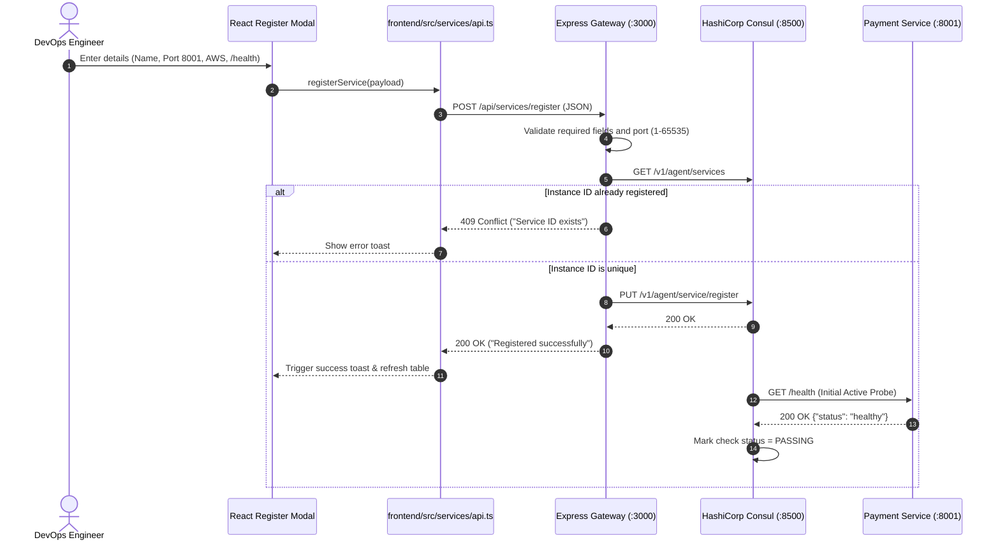
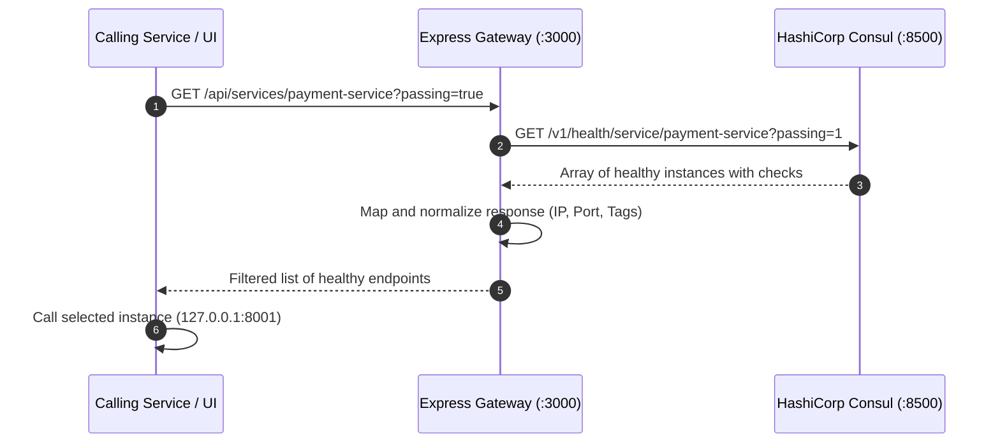
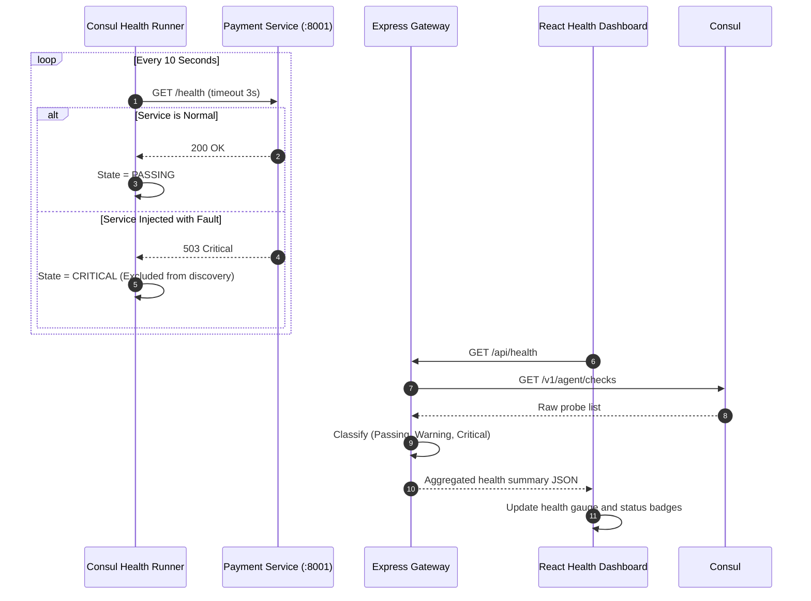

# Chapter 8: Complete Request & Execution Flow

This chapter explains what happens internally step by step when users interact with the system.

---

## 8.1 Service Registration Execution Flow

---

## 8.2 Service Discovery Execution Flow

---

## 8.3 Active Health Monitoring & Failure Triage Flow

