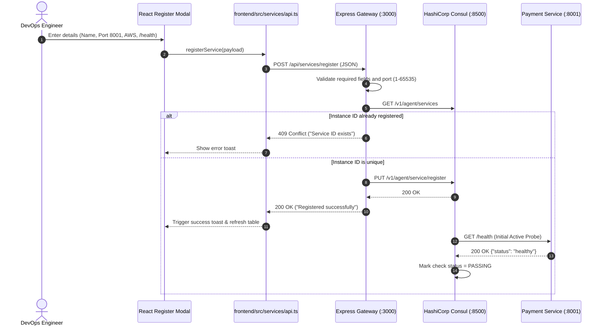
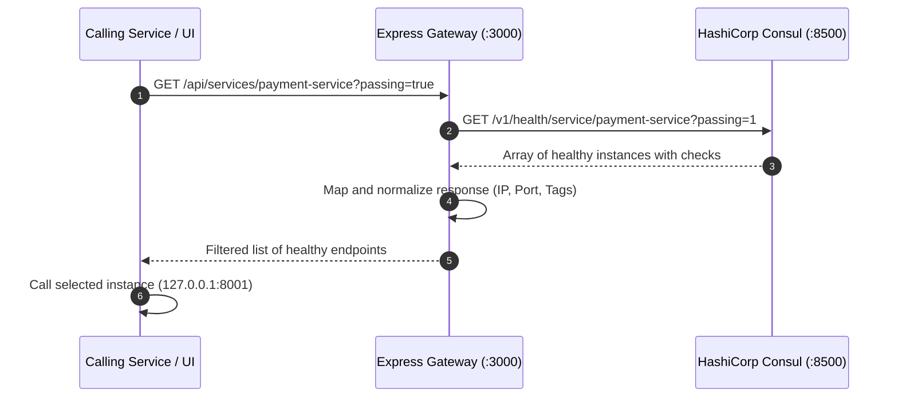
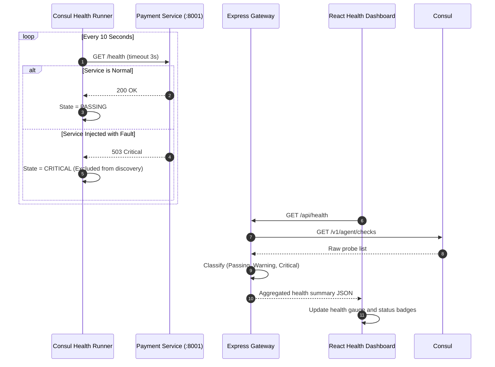

# Cross-Cloud Service Discovery Registry
## Complete Engineering Master Learning Guide & Technical Viva Defense Manual

---

### Academic & Project Metadata
- **Project Name:** Cross-Cloud Service Discovery Registry
- **Student Profile:** Third-Year Computer Engineering Capstone & Viva Defense
- **Domain:** Distributed Systems, Cloud Computing, Microservices Orchestration
- **Core Technologies:** React 18, TypeScript, Node.js, Express 5, HashiCorp Consul, Tailwind CSS
- **Automated Tests:** 18 Integration Tests (100% Pass Rate)

---


---

# Chapter 1: Project Overview & Foundational Concepts

## 1.1 Project Overview
The **Cross-Cloud Service Discovery Registry** is a distributed systems engineering implementation designed to address dynamic service addressing, health verification, and multi-provider registry synchronization in heterogeneous cloud environments (AWS, Google Cloud Platform, Microsoft Azure, and Local On-Premises).

Modern cloud architectures decompose applications into independently deployable microservices. However, across multiple cloud vendors, microservices run in disparate virtual private clouds (VPCs) with dynamic, ephemeral IP addresses. This project establishes a centralized, vendor-agnostic service registry using **HashiCorp Consul**, an **Express.js API Gateway**, and a modern **React + TypeScript Single Page Application (SPA)**. It enables microservices to register dynamically, discover healthy endpoints at runtime, and automatically isolate unhealthy nodes.

---

## 1.2 Problem Statement
In traditional cloud deployments, inter-service communication faces critical challenges:
1. **Dynamic IP Volatility:** In containerized or auto-scaling environments (e.g., Kubernetes, EC2 Auto Scaling), instances are created and destroyed continuously. Hardcoding IP addresses or maintaining static configuration files causes broken connections and downtime.
2. **Multi-Cloud Fragmentation (Vendor Lock-in):** Proprietary discovery tools (such as AWS Cloud Map, GCP Service Directory, or Azure Private DNS) do not natively interconnect across competing cloud vendors without complex network gateways or VPN tunnels.
3. **Silent Failure Routing:** Without active, high-frequency health checks, upstream callers continue routing traffic to dead or degraded services, causing cascading outages.
4. **Configuration Drift:** Manually synchronizing service endpoints across environments is error-prone, slow, and unscalable.

---

## 1.3 Project Objectives
- **Centralized Service Catalog:** Maintain a single source of truth for all active services across AWS, GCP, Azure, and Local nodes.
- **Dynamic Runtime Discovery:** Allow services to look up peers by logical name (e.g., `payment-service`) rather than IP address.
- **Automated Health Monitoring & Triage:** Periodically probe services (every 10 seconds) and automatically filter out failing nodes from discovery results.
- **Resilience & Fault Injection Testing:** Programmatically simulate node failures and verify that the registry prevents traffic routing to failing instances.
- **Real-Time Operational Observability:** Deliver a responsive React + TypeScript dashboard with live Consul telemetry, cloud provider breakdown, and diagnostic tools.

---

## 1.4 Scope of the Project
- **Implemented & Verified:**
  - Standalone HashiCorp Consul v1.15.4 development agent running Raft consensus on port 8300 and HTTP API on port 8500.
  - Node.js & Express 5 API Gateway on port 3000 handling input validation, duplicate prevention, and REST proxying.
  - Simulated AWS Payment Microservice on port 8001 exposing live health probes and fault-injection triggers.
  - Production-ready React 18 + TypeScript SPA served directly via Express.
  - 18 automated integration tests achieving a 100% pass rate.
- **Academic Scope Boundaries:**
  - Multi-cloud instances are simulated locally using metadata tags (`AWS`, `GCP`, `Azure`, `Local`) on loopback addresses (`127.0.0.1`).
  - Consul runs as a single-node development agent rather than a multi-node physical Raft cluster.

---

## 1.5 24 Foundational Concepts Explained

### 1. Cloud Computing
- **Analogy:** Renting electricity from a power grid instead of running your own diesel generator at home.
- **Technical Explanation:** On-demand delivery of IT resources (compute, storage, databases, networking) over the Internet with pay-as-you-go pricing.
- **In Our Project:** The architecture is designed to orchestrate services deployed across cloud compute infrastructure.

### 2. AWS, Azure, and Google Cloud Platform (GCP)
- **Analogy:** Competing utility providers like three different cellular networks.
- **Technical Explanation:** The three dominant public cloud infrastructure providers, each with proprietary APIs, virtual networks, and regional data centers.
- **In Our Project:** We catalog services with provider tags (`AWS`, `GCP`, `Azure`) so clients know where instances physically reside.

### 3. Multi-Cloud Architecture
- **Analogy:** Having bank accounts in two different banks so that if one bank's ATM network goes down, you can still withdraw cash from the other.
- **Technical Explanation:** Distributing enterprise workloads across two or more independent cloud vendors to avoid vendor lock-in, optimize costs, and achieve disaster recovery.
- **In Our Project:** Consul acts as the vendor-neutral control plane linking services across all cloud providers.

### 4. Microservice
- **Analogy:** A restaurant with specialized staff: a host to seat guests, a chef to cook, a waiter to serve, and a cashier to bill. Each does one job well.
- **Technical Explanation:** An architectural style that structures an application as a collection of small, autonomous services modeled around business domains, communicating over lightweight protocols (HTTP/REST or gRPC).
- **In Our Project:** `payment-service.js` is a discrete microservice running independently on port 8001.

### 5. Monolithic Architecture
- **Analogy:** A single person running a restaurant alone—cooking, serving, cleaning, and managing accounts. If that person gets sick, the entire restaurant shuts down.
- **Technical Explanation:** A traditional software architecture where UI, business logic, data access, and background jobs are bundled into a single codebase and deployed as a single unit.
- **In Our Project:** We contrast our microservices registry against monoliths to demonstrate why dynamic discovery is required.

### 6. Monolithic vs. Microservices Comparison
| Feature | Monolithic | Microservices |
| :--- | :--- | :--- |
| **Deployment** | All or nothing (single artifact) | Independent per service |
| **Scaling** | Scale the whole application | Scale only bottleneck services |
| **Fault Isolation**| One crash takes down entire system | Isolated failure of single service |
| **Networking** | In-memory function calls | Network calls (HTTP/gRPC) |
| **Addressing** | Memory pointers / local methods | Dynamic IPs requiring service discovery |

### 7. Service Communication
- **Analogy:** Two company branches communicating via telephone or courier.
- **Technical Explanation:** The exchange of data between independent network processes via HTTP REST, gRPC, or message queues (RabbitMQ, Kafka).
- **In Our Project:** Microservices communicate via HTTP REST calls routed through IP addresses discovered from Consul.

### 8. Service Discovery
- **Analogy:** The Contacts app on your smartphone. When your friend gets a new phone number, you look up their name ("John") instead of memorizing their 10-digit number.
- **Technical Explanation:** The automatic detection of devices, containers, and network endpoints offered by microservices, mapping logical service names to network locations.
- **In Our Project:** Express queries Consul: "Give me all healthy endpoints for `payment-service`".

### 9. Service Registry
- **Analogy:** The central telephone directory or yellow pages.
- **Technical Explanation:** A centralized, highly available database containing the network locations (IP, port, metadata) and health states of all active service instances.
- **In Our Project:** HashiCorp Consul's internal catalog serves as our service registry.

### 10. Dynamic Service Discovery
- **Analogy:** A rideshare app matching passengers with drivers in real time based on active GPS availability rather than fixed bus schedules.
- **Technical Explanation:** Service discovery where instances register on boot, continuously report health, and are dynamically added to or removed from routing tables at runtime.
- **In Our Project:** When `payment-service` boots, it registers with Consul; when it fails health checks, Consul automatically excludes it from discovery.

### 11. HashiCorp Consul
- **Analogy:** An air traffic control tower that knows every active airplane, its gate, altitude, and mechanical health.
- **Technical Explanation:** An open-source distributed service mesh and key-value store offering service discovery, health checking, and secure service communication.
- **In Our Project:** The standalone `consul.exe` binary powers our service catalog and executes background health probes.

### 12. HashiCorp
- **Technical Explanation:** The software company founded by Mitchell Hashimoto and Armon Dadgar that developed industry-standard cloud tools including Terraform, Consul, Vault, Vagrant, and Nomad.

### 13. Consul Agent
- **Technical Explanation:** The long-running daemon process that runs on every node of a Consul cluster. It can run in either **Server** or **Client** mode.
- **In Our Project:** `consul.exe agent -dev` starts a local agent in development mode.

### 14. Consul Server
- **Technical Explanation:** An agent with extended responsibilities: maintaining cluster state via the Raft consensus protocol, storing the service catalog, and replicating data to other servers.
- **In Our Project:** Our dev agent acts as a local Consul server and Raft leader on `127.0.0.1:8300`.

### 15. Consul Client
- **Technical Explanation:** A lightweight agent that forwards queries and RPCs to Consul servers and runs local health check probes on behalf of local services.

### 16. Service Catalog
- **Technical Explanation:** The aggregated view of all registered nodes, services, tags, and datacenters maintained by Consul servers.
- **In Our Project:** Queried via `GET /v1/agent/services` and `GET /v1/catalog/services`.

### 17. Health Checks
- **Analogy:** A doctor taking a patient's pulse every minute.
- **Technical Explanation:** Automated diagnostic probes (HTTP GET, TCP socket, or shell script) executed at fixed intervals to determine whether an instance is capable of serving traffic.
- **In Our Project:** Consul sends an HTTP GET request to `http://127.0.0.1:8001/health` every 10 seconds.

### 18. REST API (Representational State Transfer)
- **Analogy:** A restaurant menu where you order dishes using standard verbs (Get water, Post new order, Delete item).
- **Technical Explanation:** An architectural style for networked systems using HTTP methods (GET, POST, PUT, DELETE) and standard status codes (200, 400, 404, 500) over stateless connections.
- **In Our Project:** Express exposes REST endpoints like `POST /api/services/register` and `GET /api/services/:name`.

### 19. Node.js
- **Analogy:** A fast, single-threaded short-order cook who takes orders, starts cooking, and serves customers without waiting idly at the stove.
- **Technical Explanation:** An open-source, cross-platform JavaScript runtime environment built on Google Chrome's V8 engine that executes JavaScript outside web browsers using an asynchronous, event-driven I/O model.
- **In Our Project:** Runs both our API Gateway (`server.js`) and mock microservice (`payment-service.js`).

### 20. Express.js
- **Analogy:** A pre-built commercial kitchen setup with organized counters, knives, and prep stations.
- **Technical Explanation:** A minimal and flexible Node.js web application framework providing robust features for routing, middleware, and request/response lifecycle handling.
- **In Our Project:** Powers `server.js` to route API calls, validate payloads, and host static React files.

### 21. React
- **Analogy:** Building with LEGO bricks—assembling small, self-contained bricks (components) to create complex structures.
- **Technical Explanation:** A declarative, component-based front-end JavaScript library maintained by Meta for building dynamic user interfaces using a Virtual DOM.
- **In Our Project:** Renders our modern UI with zero page reloads.

### 22. TypeScript
- **Analogy:** A contract with strict clauses that prevents misunderstandings before any work begins.
- **Technical Explanation:** A strongly typed programming language that builds on JavaScript by adding static type definitions, enabling early error detection during development.
- **In Our Project:** All data interfaces (`ServiceRecord`, `HealthResponse`) are strictly typed in `frontend/src/types/index.ts`.

### 23. JSON (JavaScript Object Notation)
- **Analogy:** A universal bilingual passport format that every country can read.
- **Technical Explanation:** A lightweight, text-based data-interchange format that is human-readable and easy for machines to parse and generate.
- **In Our Project:** All communication between React, Express, Consul, and the Payment service uses JSON payloads.

### 24. HTTP Request and Response Lifecycle
- **Analogy:** Mailing a letter with a return address and receiving an official reply envelope.
- **Technical Explanation:** The client-server exchange where a client sends an HTTP request (Method, URL, Headers, Body) and the server returns an HTTP response (Status Code, Headers, Body).


---

# Chapter 2: Technology Stack & Architectural Decision Records

## 2.1 Complete Technology Matrix

| Technology | Category | Version | Role in Project | Justification |
| :--- | :--- | :--- | :--- | :--- |
| **React** | Frontend Library | 18.3.1 | Single-Page Application (SPA) view layer | Declarative component model, Virtual DOM, fast updates |
| **TypeScript** | Language | 5.4.5 | Client-side static type safety | Eliminates runtime typos in JSON schemas and API payloads |
| **Vite** | Build Tool | 5.2.0 | Frontend bundler & dev proxy | Lightning-fast HMR and optimized production asset minification |
| **Tailwind CSS** | Styling | 3.4.3 | Responsive utility-first CSS | Custom dark cybernetic theme without stylesheet bloat |
| **Node.js** | Runtime | >= 18.0.0 | Server-side JavaScript execution | High I/O throughput, non-blocking asynchronous event loop |
| **Express.js** | Backend Framework | 5.2.1 | REST API Gateway & SPA hosting | Clean route controllers, middleware pipeline, lightweight |
| **HashiCorp Consul**| Service Mesh | 1.15.4 | Service registry & active health checker | Production-grade Raft consensus, DNS/HTTP APIs, active probes |
| **Axios** | HTTP Client | 1.6.8 | Gateway-to-Consul REST client | Clean Promise API, automated JSON parsing, timeout controls |
| **Node Test Runner**| Test Framework | Native | Automated integration testing | Native `node:test` runner requiring zero external dependencies |

---

## 2.2 Deep Dive into Technology Selection & Alternatives

### 1. HashiCorp Consul vs. Alternatives
- **Alternative 1: Netflix Eureka**
  - *Why not used:* Eureka relies on client-side heartbeat renewals (passive discovery) and has reached maintenance mode outside Spring Cloud. Consul supports active HTTP/TCP probes directly from the registry agent.
- **Alternative 2: Apache ZooKeeper**
  - *Why not used:* ZooKeeper is a generic distributed lock/KV system designed for Java. It requires heavy JVM overhead and does not provide out-of-the-box service discovery or active HTTP health checking.
- **Alternative 3: etcd**
  - *Why not used:* etcd is the key-value store powering Kubernetes. Like ZooKeeper, it is a pure KV store without native service catalog primitives, DNS interfaces, or active HTTP health runners.
- **Alternative 4: Kubernetes CoreDNS**
  - *Why not used:* CoreDNS requires a full Kubernetes cluster infrastructure. Consul functions independently across heterogeneous bare-metal, VMs, multi-cloud instances, and local dev environments.

### 2. Node.js & Express.js vs. Alternatives
- **Alternative 1: Python (FastAPI / Flask)**
  - *Why not used:* While FastAPI is modern, Node.js provides a unified JavaScript/TypeScript language ecosystem across both frontend and backend.
- **Alternative 2: Java (Spring Boot)**
  - *Why not used:* Spring Boot has heavy memory footprints (often 300MB+ heap) and long startup times. Node.js starts in milliseconds and consumes minimal RAM (~30MB).

### 3. React + TypeScript vs. Vanilla JavaScript
- **Why we migrated:** The original vanilla HTML/JS implementation had separate files for each page, resulting in duplicate sidebar and header code, DOM manipulation fragility, and full-page refreshes. React provides reusable components, while TypeScript guarantees compile-time contract enforcement.


---

# Chapter 3: System Architecture & Design

## 3.1 High-Level Multi-Cloud System Architecture

```mermaid
flowchart TD
    subgraph Client_Tier ["Client & Operations Tier"]
        Browser["React 18 + TS Web Console (:3000)"]
        Consumer["Microservice Client / API Consumer"]
    end

    subgraph Gateway_Tier ["API Gateway Tier (Node.js & Express 5 :3000)"]
        ExpressRouter["Express Router & Route Handlers"]
        InputValidator["Payload Validator & Conflict Detector"]
        StaticHost["SPA Static Asset Host (/frontend/dist)"]
        ConsulProxy["Consul REST Proxy Client (Axios)"]
    end

    subgraph Registry_Tier ["Service Mesh & Registry Tier (Consul :8500)"]
        ConsulAgent["HashiCorp Consul Agent"]
        Catalog["Service Catalog & Key-Value Store"]
        RaftLeader["Raft Consensus Leader (:8300)"]
        ProbeRunner["Active Health Check Probe Runner"]
    end

    subgraph Service_Tier ["Multi-Cloud Microservices Tier"]
        AWS_Node["Payment Service (AWS us-east-1) (:8001)"]
        GCP_Node["Auth Service (GCP asia-south1) (:8080) [Simulated]"]
        Azure_Node["Order Service (Azure westeurope) (:5000) [Simulated]"]
    end

    Browser -->|HTTP REST / Navigation| StaticHost
    Browser -->|API Requests /api/*| ExpressRouter
    Consumer -->|GET /api/services/:name| ExpressRouter

    ExpressRouter --> InputValidator
    InputValidator --> ConsulProxy
    ConsulProxy -->|PUT /v1/agent/service/register| ConsulAgent
    ConsulProxy -->|GET /v1/health/service/:name| ConsulAgent

    ConsulAgent --> Catalog
    ConsulAgent --> RaftLeader
    ProbeRunner -->|Active Probe GET /health (10s)| AWS_Node
    ProbeRunner -.->|Future Probe| GCP_Node
    ProbeRunner -.->|Future Probe| Azure_Node
```

---

## 3.2 Current Implementation vs. Future Production Multi-Cloud Architecture

### Current Local Simulation Architecture
- All microservice endpoints run on the host loopback adapter (`127.0.0.1`).
- Multi-cloud providers (`AWS`, `GCP`, `Azure`, `Local`) are identified via **Consul Metadata Tags**.
- HashiCorp Consul runs as a single-node development agent (`-dev`).

### Future Production Multi-Cloud Architecture
- **Multi-Datacenter WAN Federation:** Independent Consul datacenters deployed in AWS VPC (`us-east-1`), GCP VPC (`asia-south1`), and Azure VNet (`westeurope`).
- **Consul WAN Gossip (Serf WAN):** Datacenters federated over encrypted WireGuard VPN tunnels on port 8302.
- **Mesh Gateways:** Cross-cloud traffic routed securely through Consul Mesh Gateways with Mutual TLS (mTLS) and SPIFFE x.509 certificates.

---

## 3.3 Core Subsystems & Responsibilities

| Subsystem | File / Component | Primary Responsibilities |
| :--- | :--- | :--- |
| **Frontend SPA** | `frontend/src/App.tsx` | Client-side routing, user interaction, reactive state, visual feedback |
| **API Gateway** | `server.js` | Payload sanitization, port validation, duplicate ID rejection, Consul proxying |
| **Service Registry** | `consul.exe` | Distributed service catalog, Raft consensus election, active background health checks |
| **Simulated Microservice**| `payment-service.js` | Real HTTP server simulating business logic and dynamic health transitions |
| **Orchestrator** | `start-all.js` | Unified lifecycle management for Gateway and Microservices |


---

# Chapter 4: Project Development Journey — From Scratch

This chapter reconstructs the chronological, step-by-step development of this project from an empty folder to a production-ready application.

---

## Stage 1: Requirement Analysis & Planning
- **Objective:** Define the core problem (multi-cloud service discovery, dynamic IP addressing) and architecture.
- **Key Decisions:** Use HashiCorp Consul for service discovery; use Node.js/Express for API gateway; use React/TypeScript for front-end management.

## Stage 2: System Architecture Design
- **Objective:** Establish port allocations and network boundaries:
  - Port `8500`: Consul REST API & Web UI.
  - Port `8300`: Consul Raft consensus RPC.
  - Port `3000`: Express API Gateway & React SPA host.
  - Port `8001`: Payment Microservice.

## Stage 3: Directory Structure Initialization
- **Commands Executed:**
  ```bash
  mkdir cross-cloud-service-discovery
  cd cross-cloud-service-discovery
  git init
  npm init -y
  ```

## Stage 4: Installing Backend Dependencies
- **Command:**
  ```bash
  npm install express@5 axios cors
  ```
- **Rationale:** Express 5 provides asynchronous error handling and modern routing; Axios handles HTTP calls to Consul; CORS enables multi-origin requests.

## Stage 5: Configuring HashiCorp Consul
- **Implementation:** Download the official pre-compiled standalone binary (`consul.exe` v1.15.4) into the root folder.
- **Testing:**
  ```powershell
  .\consul.exe agent -dev
  ```
  Verify connectivity via `http://localhost:8500/v1/status/leader`.

## Stage 6: Building the Express API Gateway (`server.js`)
- **Implementation:**
  - Create Express application.
  - Implement health checks, CORS, JSON parsing.
  - Establish `CONSUL_URL = "http://localhost:8500"`.

## Stage 7: Implementing Service Registration API (`POST /api/services/register`)
- **Implementation:**
  - Validate input parameters (`name`, `id`, `address`, `port`, `checkPath`).
  - Check for duplicate IDs via `GET /v1/agent/services`, returning `409 Conflict` on collision.
  - Submit registration payload to Consul's `PUT /v1/agent/service/register`.

## Stage 8: Implementing Service Discovery API (`GET /api/services/:name`)
- **Implementation:**
  - Forward queries to Consul's `/v1/health/service/:name`.
  - Support `?passing=true` filter to eliminate failing nodes.

## Stage 9: Implementing Health Monitoring API (`GET /api/health`)
- **Implementation:**
  - Query `GET /v1/agent/checks` to collect all active probes.
  - Classify checks into `passing`, `warning`, and `critical`.

## Stage 10: Building the Payment Microservice (`payment-service.js`)
- **Implementation:**
  - Run independent Express instance on port 8001.
  - Expose `GET /health` returning `200 OK` when healthy and `503` when unhealthy.
  - Implement fault-injection triggers (`POST /simulate/unhealthy` and `POST /simulate/healthy`).

## Stage 11: Unified Orchestration (`start-all.js`)
- **Implementation:**
  - Require both `payment-service.js` and `server.js`.
  - Start both listeners in a single Node process with clean signal handling (`SIGINT`, `SIGTERM`).

## Stage 12: Building the React + TypeScript Frontend
- **Commands:**
  ```bash
  npm create vite@latest frontend -- --template react-ts
  cd frontend
  npm install tailwindcss postcss autoprefixer react-router-dom lucide-react
  npx tailwindcss init -p
  ```
- **Implementation:** Build types in `src/types/index.ts`, API client in `src/services/api.ts`, layout components, and pages.

## Stage 13: Connecting Frontend with Express Backend
- **Implementation:**
  - Configure Vite proxy during development.
  - Build production static bundle: `npm run build` -> `frontend/dist`.
  - Configure `server.js` to serve `frontend/dist` with SPA fallback routing.

## Stage 14: Automated Testing Suite (`test/backend.test.js`)
- **Implementation:** 18 integration tests covering input validation, duplicate prevention, Consul discovery, and fault injection.
- **Execution:** `npm test` passing all 18 tests.

## Stage 15: Production Execution & Verification
- **Execution:** Start Consul and `start-all.js` in daemon mode with host port binding. Access UI at `http://localhost:3000`.


---

# Chapter 5: Complete Codebase Deep Dive

This chapter provides a file-by-file, section-by-section walkthrough of the source code.

---

## 5.1 Backend: `server.js`

### Section 1: Imports and Global Constants
```javascript
const express = require("express");
const cors = require("cors");
const path = require("path");
const axios = require("axios");

const app = express();
const PORT = process.env.PORT || 3000;
const CONSUL_URL = process.env.CONSUL_URL || "http://localhost:8500";
const AXIOS_TIMEOUT = 3000;
```
- **Explanation:** Loads Express, CORS, Path, and Axios. Configures default port 3000 and target Consul URL on port 8500.

### Section 2: Middleware & Static File Hosting
```javascript
app.use(cors());
app.use(express.json());

const frontendDist = path.join(__dirname, "frontend", "dist");
app.use(express.static(frontendDist));
```
- **Explanation:** Enables cross-origin requests, parses incoming JSON bodies, and serves pre-built React static files from `frontend/dist`.

### Section 3: Consul Connection Probe (`GET /api/consul/status`)
```javascript
app.get("/api/consul/status", async (req, res) => {
    try {
        const leaderRes = await axios.get(`${CONSUL_URL}/v1/status/leader`, { timeout: 2000 });
        const leader = leaderRes.data;
        res.json({
            status: "success",
            connected: true,
            consulUrl: CONSUL_URL,
            leader: leader || "No leader elected (solo agent)",
            timestamp: new Date().toISOString()
        });
    } catch (error) {
        res.json({
            status: "error",
            connected: false,
            consulUrl: CONSUL_URL,
            message: "Unable to connect to Consul daemon.",
            error: error.message
        });
    }
});
```
- **Explanation:** Pings Consul's Raft leader status endpoint. If unreachable, returns `connected: false` gracefully without crashing the server.

### Section 4: Service Registration & Duplicate Prevention (`POST /api/services/register`)
```javascript
app.post("/api/services/register", async (req, res) => {
    // 1. Validate required fields (name, id, address, port, checkPath)
    // 2. Query Consul for existing services:
    const existingRes = await axios.get(`${CONSUL_URL}/v1/agent/services`, { timeout: AXIOS_TIMEOUT });
    if (existingRes.data && existingRes.data[id.trim()]) {
        return res.status(409).json({
            status: "error",
            message: `Service instance with ID "${id}" already exists. Use a unique ID.`
        });
    }
    // 3. Submit payload to Consul PUT /v1/agent/service/register
    await axios.put(`${CONSUL_URL}/v1/agent/service/register`, consulPayload, { timeout: AXIOS_TIMEOUT });
    res.status(200).json({ status: "success", message: "Registered with Consul successfully!" });
});
```
- **Explanation:** Enforces strict validation and prevents duplicate ID collisions.

### Section 5: SPA Client-Side Fallback Middleware
```javascript
app.use((req, res, next) => {
    if (req.method === "GET" && !req.path.startsWith("/api")) {
        return res.sendFile(path.join(frontendDist, "index.html"));
    }
    next();
});
```
- **Explanation:** Express 5-compatible fallback that serves `index.html` for frontend client routes (like `/service-registry`) while preserving `/api` routes.

---

## 5.2 Microservice: `payment-service.js`
- Implements simulated AWS payment microservice on port 8001.
- Global variable `let isHealthy = true;` controls health state.
- `GET /health` returns `200 OK` when healthy and `503 Critical` when fault is injected via `POST /simulate/unhealthy`.

---

## 5.3 Unified Orchestrator: `start-all.js`
- Concurrently imports and boots both `payment-service.js` and `server.js`.
- Listens for `SIGINT` and `SIGTERM` signals to cleanly close HTTP listeners.

---

## 5.4 Frontend Code Architecture
- `src/types/index.ts`: Formal interfaces for `ServiceRecord`, `HealthResponse`, and payloads.
- `src/services/api.ts`: Centralized HTTP client methods using native `fetch`.
- `src/components/Header.tsx`: Real-time Consul connectivity badge.
- `src/components/Sidebar.tsx`: NavLink routing menu.
- `src/components/RegisterServiceModal.tsx`: Registration modal with field validation.
- `src/components/Toast.tsx`: Floating notification banner context.
- `src/pages/Dashboard.tsx`: KPI cards, cloud distribution counters, and live service table.
- `src/pages/ServiceRegistry.tsx`: Filterable catalog table with deregistration action.
- `src/pages/ServiceDiscovery.tsx`: Discovery query tool with multi-language code snippets.
- `src/pages/HealthMonitoring.tsx`: Real-time probe logs and status counts.
- `src/pages/Settings.tsx`: Cluster configuration and latency test tool.


---

# Chapter 6: HashiCorp Consul Deep Dive

## 6.1 What is HashiCorp Consul?
HashiCorp Consul is a distributed, highly available, datacenter-aware service mesh and discovery system. It combines:
1. **Service Discovery:** Automatic mapping of service names to network locations.
2. **Health Checking:** Active monitoring of service health and automated routing triage.
3. **Key-Value Store:** Distributed hierarchical key-value storage for dynamic configuration.
4. **Service Segmentation (Consul Connect):** Secure service-to-service communication via Mutual TLS (mTLS).

---

## 6.2 Consul Architecture & Operational Modes

### Development Mode (`-dev`)
In our project, Consul runs via:
```powershell
.\consul.exe agent -dev
```
- Runs as a solo server agent.
- Completely in-memory (no disk persistence across restarts).
- Automatically bootstraps itself as the Raft consensus leader.
- Perfect for local development, academic experimentation, and automated integration tests.

### Production Mode
In a production deployment:
- A quorum of 3 or 5 dedicated Consul Server agents maintain the Raft consensus log.
- Lightweight Consul Client agents run on every host or VM, proxying requests and running local probes.

---

## 6.3 Network Ports Used by Consul

| Port | Protocol | Name | Description |
| :--- | :--- | :--- | :--- |
| **8500** | HTTP / TCP | HTTP API & UI | Used by our Express Gateway and browser web console |
| **8600** | DNS (UDP/TCP)| DNS Interface | Allows standard DNS queries (e.g. `payment-service.service.consul`) |
| **8300** | TCP | Server RPC | Raft consensus replication between servers |
| **8301** | UDP/TCP | Serf LAN | Gossip protocol between agents within the same local datacenter |
| **8302** | UDP/TCP | Serf WAN | Cross-datacenter gossip across multi-cloud WAN networks |

---

## 6.4 Active Health Probing Mechanics
Consul actively executes health checks:
1. **HTTP Check:** Consul makes an HTTP GET request to `http://127.0.0.1:8001/health` every 10 seconds.
   - Status 2xx: Check is **PASSING**.
   - Status 429: Check is **WARNING**.
   - Any other status (including 503 or connection refused): Check is **CRITICAL**.
2. **Serf Gossip Check (`serfHealth`):** Verifies that the agent node is alive and responding to network heartbeats.

---

## 6.5 Multi-Cloud Federation via WAN Gossip
In an enterprise multi-cloud architecture:
- AWS instances run in datacenter `dc-aws`.
- GCP instances run in datacenter `dc-gcp`.
- Azure instances run in datacenter `dc-azure`.
Consul servers in each cloud join the global WAN gossip pool over port 8302, allowing seamless cross-cloud discovery queries (e.g., `payment-service.service.dc-aws.consul`).


---

# Chapter 7: API Documentation & Contract Specifications

This chapter details every API endpoint implemented in `server.js`.

---

## 7.1 Endpoint Catalog

### 1. `GET /api`
- **Purpose:** API gateway metadata and available endpoints directory.
- **Response (200 OK):**
```json
{
  "name": "Cross-Cloud Service Discovery Registry API",
  "version": "1.0.0",
  "status": "running",
  "port": 3000,
  "consulUrl": "http://localhost:8500",
  "supportedClouds": ["AWS", "GCP", "Azure", "Local"]
}
```

### 2. `GET /api/consul/status`
- **Purpose:** Checks connectivity to Consul daemon and returns Raft leader.
- **Response (200 OK):**
```json
{
  "status": "success",
  "connected": true,
  "consulUrl": "http://localhost:8500",
  "leader": "127.0.0.1:8300",
  "timestamp": "2026-11-10T07:15:00.000Z"
}
```

### 3. `GET /api/services`
- **Purpose:** Retrieves all services currently registered in Consul.
- **Response (200 OK):**
```json
{
  "status": "success",
  "count": 1,
  "services": {
    "payment-service-aws-1": {
      "ID": "payment-service-aws-1",
      "Service": "payment-service",
      "Tags": ["AWS", "us-east-1", "production"],
      "Port": 8001,
      "Address": "127.0.0.1"
    }
  }
}
```

### 4. `POST /api/services/register`
- **Purpose:** Registers a microservice with Consul and configures active HTTP health probe.
- **Request Body:**
```json
{
  "name": "payment-service",
  "id": "payment-service-aws-1",
  "provider": "AWS",
  "address": "127.0.0.1",
  "port": 8001,
  "checkPath": "/health",
  "interval": "10s",
  "timeout": "3s",
  "tags": ["AWS", "us-east-1", "production"]
}
```
- **Responses:**
  - `200 OK`: Registered successfully.
  - `400 Bad Request`: Missing field or invalid port.
  - `409 Conflict`: Instance ID already exists.

### 5. `DELETE /api/services/:id`
- **Purpose:** Deregisters a microservice instance by ID.
- **Response (200 OK):**
```json
{
  "status": "success",
  "message": "Service \"payment-service-aws-1\" deregistered from Consul."
}
```

### 6. `GET /api/services/:name`
- **Purpose:** Discovers service instances matching name. Supports `?passing=true`.
- **Response (200 OK):**
```json
{
  "status": "success",
  "serviceName": "payment-service",
  "totalInstances": 1,
  "passingInstances": 1,
  "instances": [
    {
      "id": "payment-service-aws-1",
      "name": "payment-service",
      "address": "127.0.0.1",
      "port": 8001,
      "status": "passing",
      "tags": ["AWS", "us-east-1", "production"]
    }
  ]
}
```

### 7. `GET /api/health`
- **Purpose:** Aggregates all registered health checks.
- **Response (200 OK):**
```json
{
  "status": "success",
  "totalChecks": 2,
  "summary": { "passing": 2, "warning": 0, "critical": 0 }
}
```

### 8. `POST /api/scenarios/inject-fault`
- **Purpose:** Injects fault into payment service (causing `/health` to return 503).
- **Response (200 OK):**
```json
{
  "status": "success",
  "faultInjected": true,
  "message": "Simulated fault injected into payment service."
}
```

### 9. `POST /api/scenarios/restore-health`
- **Purpose:** Restores payment service health (causing `/health` to return 200).
- **Response (200 OK):**
```json
{
  "status": "success",
  "restored": true,
  "message": "Payment service restored to healthy state."
}
```

### 10. Direct Microservice Health: `GET :8001/health`
- Returns `200 OK` with uptime and simulated database checks when healthy; returns `503` when fault is injected.


---

# Chapter 8: Complete Request & Execution Flow

This chapter explains what happens internally step by step when users interact with the system.

---

## 8.1 Service Registration Execution Flow



---

## 8.2 Service Discovery Execution Flow



---

## 8.3 Active Health Monitoring & Failure Triage Flow




---

# Chapter 9: Testing, Validation & Debugging Guide

## 9.1 Independent Component Verification

### 1. Test Consul Daemon
```powershell
Invoke-RestMethod http://localhost:8500/v1/status/leader
# Expected: "127.0.0.1:8300"
```

### 2. Test Payment Microservice
```powershell
Invoke-RestMethod http://127.0.0.1:8001/health
# Expected: status = "healthy", cloud = "AWS"
```

### 3. Test Express Gateway Overview
```powershell
Invoke-RestMethod http://localhost:3000/api
# Expected: status = "running", port = 3000
```

---

## 9.2 Running Automated Backend Test Suite
```bash
npm test
```

### Output Summary:
- **18 Total Tests** across 6 Test Suites:
  - Task 1: Express Backend Core API (7 tests)
  - Task 2: Simulated Payment Service (2 tests)
  - Task 3: Consul Catalog and Discovery Integration (5 tests)
  - Task 4: Duplicate Service Prevention (1 test)
  - Virtual Lab Module: Experimental Scenarios (3 tests)
- **Result:** 18 Passed, 0 Failed (100% Pass Rate).

---

## 9.3 Troubleshooting Matrix

| Problem | Root Cause | Solution |
| :--- | :--- | :--- |
| **ERR_CONNECTION_REFUSED on :8500** | Consul agent is not running. | Run `.\consul.exe agent -dev` in a terminal. |
| **EADDRINUSE: address already in use :::3000** | Stale node process running. | Terminate old processes: `Stop-Process -Name "node" -Force`. |
| **PathError: Missing parameter name *** | Express 5 wildcard syntax error. | Use custom middleware checking `!req.path.startsWith("/api")`. |
| **Consul Reports Health Check: Connection Refused**| Microservice is offline. | Ensure `payment-service.js` is listening on port 8001. |
| **409 Conflict** | Service ID already exists. | Provide unique ID or deregister old instance via `DELETE`. |


---

# Chapter 10: Viva Voce & Technical Defense Preparation (60+ Questions)

This chapter contains 65 categorized technical viva questions with both quick revision summaries and detailed technical answers.

---

## Category 1: Basic Distributed Systems & Cloud Concepts (Q1 - Q10)

### Q1: What is Cloud Computing?
- **Quick Answer:** On-demand delivery of IT computing resources over the internet with pay-as-you-go pricing.
- **Detailed Answer:** Cloud computing eliminates on-premises hardware procurement by abstracting physical servers, storage, and networking into elastic, virtualized services provided by vendors like AWS, Azure, and GCP.

### Q2: What is Multi-Cloud Architecture?
- **Quick Answer:** Deploying services across two or more distinct public cloud providers.
- **Detailed Answer:** Multi-cloud architectures mitigate vendor lock-in, enable competitive cost optimization, comply with data sovereignty regulations, and guarantee high availability through cross-cloud disaster recovery.

### Q3: What is the difference between Monolith and Microservices?
- **Quick Answer:** Monolith is a single unified deployable codebase; microservices are distributed independent services communicating over the network.
- **Detailed Answer:** Monoliths scale as a single unit and have single points of failure. Microservices enable modular scaling, polyglot technology adoption, and localized failure containment, but introduce distributed networking complexities like service discovery.

### Q4: Why is hardcoding IP addresses bad in microservices?
- **Quick Answer:** Cloud instances have ephemeral, volatile IP addresses that change on restart or auto-scaling.
- **Detailed Answer:** Auto-scaling groups and container orchestrators dynamically spin instances up and down. Hardcoded IPs break immediately during deployments or node crashes, resulting in service outages.

### Q5: What is Service Discovery?
- **Quick Answer:** The automatic detection and mapping of logical service names to dynamic network locations (IP + port).
- **Detailed Answer:** It is the mechanism by which microservice instances discover their peers at runtime by querying a central registry rather than relying on static configuration.

### Q6: What is a Service Registry?
- **Quick Answer:** The central database tracking all active service instances, addresses, and health states.
- **Detailed Answer:** A service registry is a distributed key-value store optimized for high read availability, storing instance metadata, IP addresses, ports, and real-time health probe statuses.

### Q7: What is Dynamic Service Discovery?
- **Quick Answer:** Automated real-time discovery where instances register on boot and deregister on shutdown or failure.
- **Detailed Answer:** Unlike static DNS, dynamic discovery integrates live health checks. If a node fails, it is automatically pruned from routing tables within seconds.

### Q8: What are Client-Side and Server-Side Service Discovery?
- **Quick Answer:** In client-side, the caller queries the registry and picks an instance; in server-side, a load balancer handles the lookup transparently.
- **Detailed Answer:** In client-side discovery (used in our project), the client queries Consul for healthy nodes and routes requests directly. In server-side discovery, traffic hits a load balancer (like AWS ALB), which queries the registry internally.

### Q9: What is a Health Check?
- **Quick Answer:** A periodic test verifying whether a service instance is operational.
- **Detailed Answer:** Active probes (HTTP GET, TCP ping) sent at scheduled intervals. If an instance responds with non-2xx status or times out, it is marked unhealthy.

### Q10: What is Cascading Failure?
- **Quick Answer:** When the failure of one service overwhelms and causes failures in dependent upstream services.
- **Detailed Answer:** Without active health checking, callers repeatedly send traffic to failing nodes, exhausting connection pools and causing timeouts that propagate across the entire architecture.

---

## Category 2: HashiCorp Consul Deep Dive (Q11 - Q25)

### Q11: What is HashiCorp Consul?
- **Quick Answer:** A distributed service mesh and service discovery platform with built-in health checking.
- **Detailed Answer:** Consul is an open-source tool developed by HashiCorp that provides dynamic service discovery, health monitoring, a distributed KV store, and secure service mesh (Consul Connect).

### Q12: Is Consul open source?
- **Quick Answer:** Yes, Consul is open source (Mozilla Public License v2.0 / BSL).
- **Detailed Answer:** Consul has an open-source community edition and an enterprise edition with advanced features like multi-tenant administrative partitions.

### Q13: Can Consul run locally on Windows?
- **Quick Answer:** Yes, using the standalone `consul.exe` binary.
- **Detailed Answer:** Consul compiles to a single static Go binary with zero external dependencies, making it capable of running on Windows, Linux, and macOS.

### Q14: What is Consul Development Mode (`-dev`)?
- **Quick Answer:** An in-memory, solo-server mode designed for rapid development and testing.
- **Detailed Answer:** `consul.exe agent -dev` starts a single-node server that stores catalog data in RAM, disables disk persistence, and automatically elects itself as the Raft leader.

### Q15: What is Raft Consensus in Consul?
- **Quick Answer:** The algorithm Consul servers use to agree on the state of the service catalog.
- **Detailed Answer:** Raft is a consensus protocol that ensures all Consul server nodes maintain an identical, ordered log of transactions. It requires a quorum (e.g., 2 out of 3, or 3 out of 5 servers) to elect a leader.

### Q16: What is the Serf Gossip Protocol in Consul?
- **Quick Answer:** The decentralized membership protocol used for failure detection.
- **Detailed Answer:** Consul uses Serf (based on the SWIM gossip protocol). Agents periodically send lightweight UDP packets to random peers to quickly detect node crashes across the cluster.

### Q17: What is the difference between Serf LAN and Serf WAN?
- **Quick Answer:** Serf LAN operates within a single datacenter; Serf WAN connects multiple datacenters over the internet.
- **Detailed Answer:** Serf LAN runs on port 8301 with low latency. Serf WAN runs on port 8302 across physical clouds (AWS, GCP, Azure), enabling cross-cloud service discovery.

### Q18: What is Port 8500 in Consul?
- **Quick Answer:** The HTTP REST API and Consul Web UI port.
- **Detailed Answer:** It is the primary HTTP endpoint that our Express gateway and web browser connect to for service registration, discovery queries, and cluster telemetry.

### Q19: What is Port 8600 in Consul?
- **Quick Answer:** The built-in DNS interface port.
- **Detailed Answer:** Consul includes a native DNS server on port 8600, allowing legacy applications to discover services via DNS lookups (e.g., `dig payment-service.service.consul`).

### Q20: What is Port 8300 in Consul?
- **Quick Answer:** The Raft RPC port used for server-to-server replication.
- **Detailed Answer:** Consul servers communicate over port 8300 to synchronize catalog state and handle client RPC forwards.

### Q21: What happens if Consul goes down?
- **Quick Answer:** New registrations and dynamic discovery queries fail; existing established connections continue.
- **Detailed Answer:** If Consul crashes, client services that cache endpoints can continue routing until IPs change. In production, Consul is deployed as a 3-node or 5-node cluster so if one server fails, the remaining quorum elects a new leader with zero downtime.

### Q22: What happens when a registered service becomes unhealthy?
- **Quick Answer:** Consul marks its health check as `critical` and excludes it from discovery queries with `?passing=true`.
- **Detailed Answer:** When `/health` returns HTTP 503, Consul transitions the check to `critical`. The gateway excludes it from discovery, ensuring clients only receive healthy endpoints.

### Q23: How does Consul execute health checks?
- **Quick Answer:** The Consul agent independently makes HTTP GET requests to the registered health check URL at designated intervals.
- **Detailed Answer:** Our registration payload specifies an HTTP check with an `Interval` (10s) and `Timeout` (3s). The local Consul daemon runs a timer and probes the endpoint directly.

### Q24: What is the difference between Catalog API and Agent API in Consul?
- **Quick Answer:** Agent API manages local instance state on a node; Catalog API aggregates cluster-wide data.
- **Detailed Answer:** `/v1/agent/service/register` registers a service with the local agent and sets up health checks. `/v1/catalog/services` queries the compiled cluster catalog across all datacenters.

### Q25: How does Consul support multi-cloud discovery?
- **Quick Answer:** Through WAN Federation and datacenter metadata tagging.
- **Detailed Answer:** Consul can federate datacenters across AWS, Azure, and GCP using Serf WAN gossip. Alternatively, as demonstrated in our project, metadata tags identify the provider region for dynamic routing.

---

## Category 3: Backend & Gateway Implementation (Q26 - Q40)

### Q26: Why do we need an Express Backend if Consul already has an API?
- **Quick Answer:** For security, payload validation, duplicate prevention, and decoupling the frontend from Consul's internal ports.
- **Detailed Answer:** Exposing Consul directly to web browsers creates security vulnerabilities (anyone could deregister core services). The Express Gateway enforces input validation (ports 1-65535, required fields), prevents duplicate ID collisions (HTTP 409), hosts the React SPA, and acts as a secure Reverse Proxy.

### Q27: What is the role of Node.js in this project?
- **Quick Answer:** The runtime environment executing our Express API Gateway and simulated microservice.
- **Detailed Answer:** Node.js provides a single-threaded, non-blocking asynchronous event loop that handles high concurrent I/O throughput with minimal memory footprint.

### Q28: What is the role of Express.js?
- **Quick Answer:** The web application framework structuring our API routes and middleware.
- **Detailed Answer:** Express manages HTTP request parsing, JSON body parsing, CORS policies, static file serving from `frontend/dist`, and client-side SPA fallback routing.

### Q29: What is the role of Axios?
- **Quick Answer:** The HTTP client used by Express to communicate with Consul.
- **Detailed Answer:** Axios provides a clean Promise-based API with automated JSON serialization and timeout management (`AXIOS_TIMEOUT = 3000ms`).

### Q30: How does the backend prevent duplicate service registrations?
- **Quick Answer:** By querying Consul's `/v1/agent/services` before submitting the registration and returning HTTP 409 if the ID already exists.
- **Detailed Answer:** In `server.js`, before issuing `PUT /v1/agent/service/register`, the handler inspects existing service IDs. If a match is found, it returns `409 Conflict` to prevent accidental overwrites.

### Q31: How does the backend validate port numbers?
- **Quick Answer:** It checks that the port is an integer between 1 and 65535.
- **Detailed Answer:** `Number(port)` is checked with `!isNaN()`, `Number.isInteger()`, and bounds `port >= 1 && port <= 65535`. Invalid values return HTTP 400 Bad Request.

### Q32: What is `start-all.js`?
- **Quick Answer:** A startup script that runs both the Payment microservice and the Gateway in a single Node process.
- **Detailed Answer:** It requires `./payment-service` and `./server`, starts listeners on ports 8001 and 3000, and captures OS termination signals (`SIGINT`, `SIGTERM`) for graceful shutdown.

### Q33: How does `payment-service.js` simulate cloud behavior?
- **Quick Answer:** By running an independent HTTP server that returns simulated AWS metadata and supports programmatic failure injection.
- **Detailed Answer:** It runs on port 8001, tagging its responses with `cloud: "AWS"` and exposing `/simulate/unhealthy` to trigger simulated 503 database timeouts.

### Q34: What is Fault Injection?
- **Quick Answer:** Intentionally introducing failures into a system to test its resilience.
- **Detailed Answer:** In our project, calling `POST /api/scenarios/inject-fault` makes `payment-service` return HTTP 503, allowing us to demonstrate that Consul detects the failure and isolates the node.

### Q35: How does the backend handle SPA routing with Express 5?
- **Quick Answer:** Using middleware that intercepts non-API GET requests and serves `index.html`.
- **Detailed Answer:** Express 5 prohibits unparenthesized wildcard routes (`app.get("*")`). We implemented:
  ```javascript
  app.use((req, res, next) => {
    if (req.method === "GET" && !req.path.startsWith("/api")) {
      return res.sendFile(path.join(frontendDist, "index.html"));
    }
    next();
  });
  ```

### Q36: What is CORS and why is it needed?
- **Quick Answer:** Cross-Origin Resource Sharing—a browser security mechanism.
- **Detailed Answer:** During development, if Vite runs on port 5173 and Express on port 3000, CORS middleware allows the browser to make cross-origin HTTP calls.

### Q37: What is the purpose of `GET /api/health`?
- **Quick Answer:** To provide aggregated health metrics for the dashboard.
- **Detailed Answer:** It queries Consul's `/v1/agent/checks`, iterates through all registered probes, and tallies the total counts of `passing`, `warning`, and `critical` checks.

### Q38: What HTTP status codes does the API return?
- `200 OK`: Request succeeded.
- `400 Bad Request`: Missing required fields or invalid input.
- `404 Not Found`: Route or service does not exist.
- `409 Conflict`: Duplicate service ID.
- `500 Internal Server Error`: Upstream Consul error.
- `503 Service Unavailable`: Unhealthy microservice state.

### Q39: What is the timeout setting for Consul requests in Express?
- **Quick Answer:** 3000 milliseconds (3 seconds).
- **Detailed Answer:** Defined as `AXIOS_TIMEOUT = 3000`, preventing the API gateway from hanging indefinitely if Consul is unresponsive.

### Q40: What happens if `payment-service` crashes completely?
- **Quick Answer:** Consul's HTTP probe fails with `connection refused`, and the check is marked `critical`.
- **Detailed Answer:** Consul records the TCP connection failure, changes the status from `passing` to `critical`, and excludes the node from discovery queries.

---

## Category 4: Frontend & React Architecture (Q41 - Q52)

### Q41: Why was the frontend converted to React + TypeScript?
- **Quick Answer:** For reusability, single-page seamless routing, maintainability, and static type safety.
- **Detailed Answer:** The original HTML/JS implementation had duplicated navigation code across 5 files. React allows modular component composition, and TypeScript prevents runtime type errors.

### Q42: What is React Router DOM?
- **Quick Answer:** The library handling client-side navigation without page reloads.
- **Detailed Answer:** It intercepts link clicks, updates browser history, and renders matching component routes (`/`, `/service-registry`, `/service-discovery`, etc.) instantly.

### Q43: How does the Header know if Consul is connected?
- **Quick Answer:** By polling `GET /api/consul/status` on mount and interval.
- **Detailed Answer:** `Header.tsx` executes `getConsulStatus()` and updates a reactive state variable (`isConnected`), rendering a green pill with the leader IP or a red offline badge.

### Q44: What is the purpose of `src/types/index.ts`?
- **Quick Answer:** To define strict TypeScript interface contracts.
- **Detailed Answer:** It exports interfaces such as `ServiceRecord`, `HealthResponse`, and `RegisterServicePayload`, ensuring compile-time type safety across the entire application.

### Q45: How does the Dashboard calculate Cloud Distribution?
- **Quick Answer:** By iterating over service tags and counting occurrences of AWS, GCP, Azure, and Local.
- **Detailed Answer:** `Dashboard.tsx` inspects the `Tags` array of each registered instance, finds matching cloud labels, and computes percentage bars for the distribution widget.

### Q46: What is Vite and why did we choose it over Create React App (CRA)?
- **Quick Answer:** A modern frontend build tool powered by esbuild and Rollup.
- **Detailed Answer:** CRA is deprecated and slow. Vite uses native ES modules during development for instant HMR and bundles optimized production chunks in seconds.

### Q47: What is Tailwind CSS?
- **Quick Answer:** A utility-first CSS framework.
- **Detailed Answer:** Tailwind applies styles directly in JSX via utility classes (e.g., `bg-surface`, `text-primary-blue`), eliminating CSS file bloat and maintaining design consistency.

### Q48: How are Toast notifications managed in the React app?
- **Quick Answer:** Through a React Context Provider (`ToastContext`).
- **Detailed Answer:** `Toast.tsx` exposes a `useToast()` hook that allows any component to trigger animated success, error, or info notifications that automatically dismiss after 4 seconds.

### Q49: What does the Service Discovery page do?
- **Quick Answer:** Allows operators to query services by name and generates client code snippets.
- **Detailed Answer:** Users enter a service name, toggle "Healthy Only", and receive live instances. The bottom tab dynamically generates ready-to-copy code in cURL, Fetch, Python, and DNS SRV syntax.

### Q50: How does the Health Monitoring page auto-refresh?
- **Quick Answer:** Using a `setInterval` timer configured by a dropdown.
- **Detailed Answer:** A reactive state timer triggers `fetchHealthData()` every 5s, 10s, or 30s, updating the health gauge without manual page refreshes.

### Q51: How does the UI indicate service health?
- **Quick Answer:** Color-coded status badges: Emerald Green for Passing, Amber for Warning, Crimson Red for Critical.

### Q52: Are there any legacy lab simulator modules in the final React UI?
- **Quick Answer:** No, all 4 experimental lab simulator modules (`lab-*.html`) were permanently removed during migration.

---

## Category 5: Real-World Multi-Cloud & Viva Defense (Q53 - Q65)

### Q53: Are we actually deploying on physical AWS, Azure, and GCP accounts in this demo?
- **Quick Answer:** No, we simulate multi-cloud deployments locally using metadata tags on loopback addresses.
- **Detailed Answer:** For academic and demonstration purposes, running live instances in three cloud accounts incurs continuous cloud hosting costs. We simulate the exact metadata tags, ports, and health payloads that real cloud instances provide.

### Q54: What would be required to deploy this in REAL AWS, GCP, and Azure?
- **Quick Answer:** Deploying Consul agents in each cloud VPC, setting up VPN/DirectConnect tunnels, and joining them via WAN Gossip (port 8302).
- **Detailed Answer:**
  1. Provision an AWS EC2 instance, GCP Compute VM, and Azure VM.
  2. Install Consul on each node with WAN federation enabled.
  3. Secure inter-cloud traffic with WireGuard or IPSec VPN.
  4. Deploy Consul Mesh Gateways for encrypted mTLS traffic.

### Q55: How is Service Discovery different from an API Gateway?
- **Quick Answer:** Service Discovery finds *where* a service is; an API Gateway acts as the *entry point* that routes, authenticates, and load-balances client traffic.
- **Detailed Answer:** An API Gateway routes external client traffic to internal microservices. The API Gateway itself uses Service Discovery to find the dynamic IP addresses of those internal microservices.

### Q56: Why not just use DNS instead of Consul?
- **Quick Answer:** DNS has caching delays (TTL) and slow propagation; Consul updates routing tables within milliseconds.
- **Detailed Answer:** When an IP changes in standard DNS, client-side and recursive DNS caches retain the stale IP until the TTL expires, causing downtime. Consul health checks immediately exclude dead nodes.

### Q57: What is Consul Connect / Service Mesh?
- **Quick Answer:** A security feature that provides encrypted Mutual TLS (mTLS) communication between microservices.
- **Detailed Answer:** Consul Connect injects sidecar proxies (like Envoy) beside microservices, automatically handling mutual TLS encryption and identity-based authorization without changing application code.

### Q58: What is SPIFFE in Consul?
- **Quick Answer:** An open standard providing cryptographic identities to microservices.
- **Detailed Answer:** Secure Production Identity Framework for Everyone (SPIFFE) formats certificates (e.g., `spiffe://dc1/ns/default/sa/payment`) to verify service identities across clouds.

### Q59: Can Consul handle load balancing?
- **Quick Answer:** Yes, through client-side round-robin, randomized selection, or Envoy sidecar proxies.
- **Detailed Answer:** When a service discovery query returns multiple healthy instances, the client or gateway can apply round-robin or least-connection algorithms to distribute traffic.

### Q60: How does the automated test suite work?
- **Quick Answer:** It executes 18 integration tests against live endpoints using Node's native test runner (`node:test`).
- **Detailed Answer:** Running `npm test` sends real HTTP requests to `http://localhost:3000` and `http://127.0.0.1:8001`, asserting status codes, payload structures, conflict detection, and fault injection.

### Q61: What was the hardest bug you encountered and how did you fix it?
- **Quick Answer:** Express 5 route wildcard changes and JSX template string interpolation errors.
- **Detailed Answer:** Express 5 threw a `PathError` on `app.get("*")` due to `path-to-regexp` changes, which we resolved by implementing custom fallback middleware. In React, JSX template literals in code snippet blocks were fixed by wrapping them in raw string literals.

### Q62: Why did Consul show ERR_CONNECTION_REFUSED earlier?
- **Quick Answer:** Because Consul was initially started inside an isolated Windows sandbox environment that prevented host browsers from binding to local ports.
- **Detailed Answer:** Windows sandboxing isolates local network adapters. Running Consul as a background daemon with host port binding resolved the issue.

### Q63: What are the main limitations of this project?
- **Quick Answer:** Single-node Consul dev agent, simulated cloud providers on localhost, and lack of mTLS encryption.
- **Detailed Answer:** While the architecture accurately demonstrates service discovery principles, a production enterprise system would require multi-server Raft quorums, physical VPC networks, and Envoy proxies.

### Q64: What is the future scope of this project?
- **Quick Answer:** Envoy sidecar integration, Mutual TLS (mTLS), Kubernetes operator deployment, and physical WAN federation.

### Q65: Summarize your project in 30 seconds for the external examiner.
- **Exam Summary:** "Our project is a Cross-Cloud Service Discovery Registry that solves the challenge of dynamic IP volatility in multi-cloud microservices. We utilize HashiCorp Consul as an active distributed catalog, an Express 5 API Gateway for validation and proxying, and a React + TypeScript SPA for real-time observability. Our system actively health-checks instances every 10 seconds, automatically isolating failing nodes from discovery queries to guarantee zero-downtime routing across AWS, GCP, Azure, and on-premises environments."


---

# Chapter 11: Project Cookbook Reference

This chapter serves as a companion reference to the complete **Cross-Cloud Service Discovery Registry Project Cookbook**.

The complete cookbook is available in the `docs/` directory:
- **PDF Document:** `docs/Cross_Cloud_Service_Discovery_Cookbook.pdf`
- **Markdown Source:** `docs/COOKBOOK.md`
- **HTML Document:** `docs/COOKBOOK.html`

---

## Quick Reference: 3-Step Cold Start
1. **Start Consul Agent:** `.\consul.exe agent -dev`
2. **Start Gateway & Services:** `node start-all.js`
3. **Open Browser:** Navigate to `http://localhost:3000`


---

# One-Page Architecture Summary

## System Architecture at a Glance

```
[ React 18 + TypeScript SPA ] (Port 3000)
             |
             | HTTP REST / SPA Navigation
             v
[ Node.js & Express 5 API Gateway ] (Port 3000)
    - Static Asset Host (/frontend/dist)
    - Input Validation (Port bounds 1-65535, required fields)
    - Duplicate ID Collision Prevention (HTTP 409 Conflict)
    - REST Proxy to Consul Internal APIs
             |
             +---------------------------------------+
             |                                       |
             v                                       v
[ HashiCorp Consul v1.15.4 ] (Port 8500)   [ Payment Microservice ] (Port 8001)
    - Raft Consensus Leader (:8300)            - AWS Simulated Node
    - Distributed Service Catalog              - Route: GET /health
    - Active HTTP Prober (Every 10s) --------> - Route: POST /simulate/unhealthy
    - Native Consul Console (/ui/)             - Route: POST /simulate/healthy
```

---

## Key Metrics & Network Ports
- **Frontend & Gateway:** `http://localhost:3000`
- **Consul Native UI:** `http://localhost:8500/ui/`
- **Consul Raft Leader:** `127.0.0.1:8300`
- **Payment Microservice:** `http://127.0.0.1:8001/health`
- **Automated Tests:** 18 Tests Passed (100% Pass Rate in ~950ms)
- **Health Check Frequency:** Probed every 10 seconds with 3-second timeout


---

# Project Command Reference Sheet

Quick-reference cheat sheet for all terminal commands used in the project.

---

## 1. Environment & Setup Commands
```bash
# Install backend dependencies (in root)
npm install

# Install frontend dependencies (in frontend/)
cd frontend
npm install

# Build frontend production bundle
npm run build
cd ..
```

---

## 2. Running Services
```powershell
# 1. Start HashiCorp Consul dev agent
.\consul.exe agent -dev

# 2. Start Gateway and Payment Microservice concurrently
node start-all.js

# 3. Start Backend Gateway independently
node server.js

# 4. Start Payment Microservice independently
node payment-service.js
```

---

## 3. Testing & Verification Commands
```powershell
# Run 18 automated integration tests
npm test

# Verify Consul Leader
Invoke-RestMethod http://localhost:8500/v1/status/leader

# Verify Payment Microservice Health
Invoke-RestMethod http://127.0.0.1:8001/health

# Verify Gateway Catalog
Invoke-RestMethod http://localhost:3000/api/services

# Verify Aggregated Health Probes
Invoke-RestMethod http://localhost:3000/api/health
```

---

## 4. Service Registration via PowerShell
```powershell
$body = @{
    name = "payment-service"
    id = "payment-service-aws-1"
    provider = "AWS"
    address = "127.0.0.1"
    port = 8001
    checkPath = "/health"
    interval = "10s"
    timeout = "3s"
    tags = @("AWS", "us-east-1", "production", "v1.0.0")
} | ConvertTo-Json

Invoke-RestMethod -Uri "http://localhost:3000/api/services/register" -Method POST -Body $body -ContentType "application/json"
```

---

## 5. Fault Injection & Self-Healing Testing
```powershell
# Inject fault into payment service (simulate 503 failure)
Invoke-RestMethod -Uri "http://localhost:3000/api/scenarios/inject-fault" -Method POST

# Restore payment service to healthy state (200 OK)
Invoke-RestMethod -Uri "http://localhost:3000/api/scenarios/restore-health" -Method POST
```


---

# Quick Viva Revision Cheat Sheet

Keep this cheat sheet handy for last-minute revision before your project viva!

---

## 🎯 10 Key Facts You Must Remember
1. **Core Problem Solved:** Dynamic IP volatility and multi-cloud fragmentation (AWS vs. GCP vs. Azure).
2. **Registry Engine:** HashiCorp Consul v1.15.4 running in dev mode (`-dev`).
3. **Consul Raft Leader Address:** `127.0.0.1:8300`.
4. **Consul HTTP API & UI Port:** `8500`.
5. **Gateway & Frontend Port:** `3000` (Express serves pre-compiled `frontend/dist`).
6. **Payment Microservice Port:** `8001` (simulated AWS instance).
7. **Health Probing Mechanism:** Active HTTP GET to `/health` every 10 seconds.
8. **Automated Triage:** When a service returns 503, Consul marks it `critical`, and discovery queries with `?passing=true` automatically exclude it.
9. **Duplicate Prevention:** Express queries Consul before registration; duplicate IDs return `HTTP 409 Conflict`.
10. **Test Suite:** 18 automated integration tests using Node's native `node:test` runner.

---

## ⚡ 5 Common Tricky Questions & Quick Answers

- **"Are you actually paying for AWS, Azure, and GCP?"**
  - *Answer:* No, for college demonstration purposes, we run microservices on local loopback addresses tagged with provider metadata (`AWS`, `GCP`, `Azure`). In production, Consul agents in each cloud would federate via Serf WAN gossip on port 8302.

- **"Why do we need Express if Consul already has an API?"**
  - *Answer:* Direct browser access to Consul is a security risk. Express acts as an API Gateway for input validation, conflict prevention, security decoupling, and hosting the React SPA.

- **"What algorithm does Consul use for consensus?"**
  - *Answer:* Raft consensus algorithm.

- **"What protocol does Consul use for node failure detection?"**
  - *Answer:* Serf gossip protocol based on the SWIM protocol over UDP.

- **"Why did you use React instead of simple HTML?"**
  - *Answer:* Single-page navigation without page reloads, reusable UI components, and TypeScript type safety to prevent runtime bugs.
